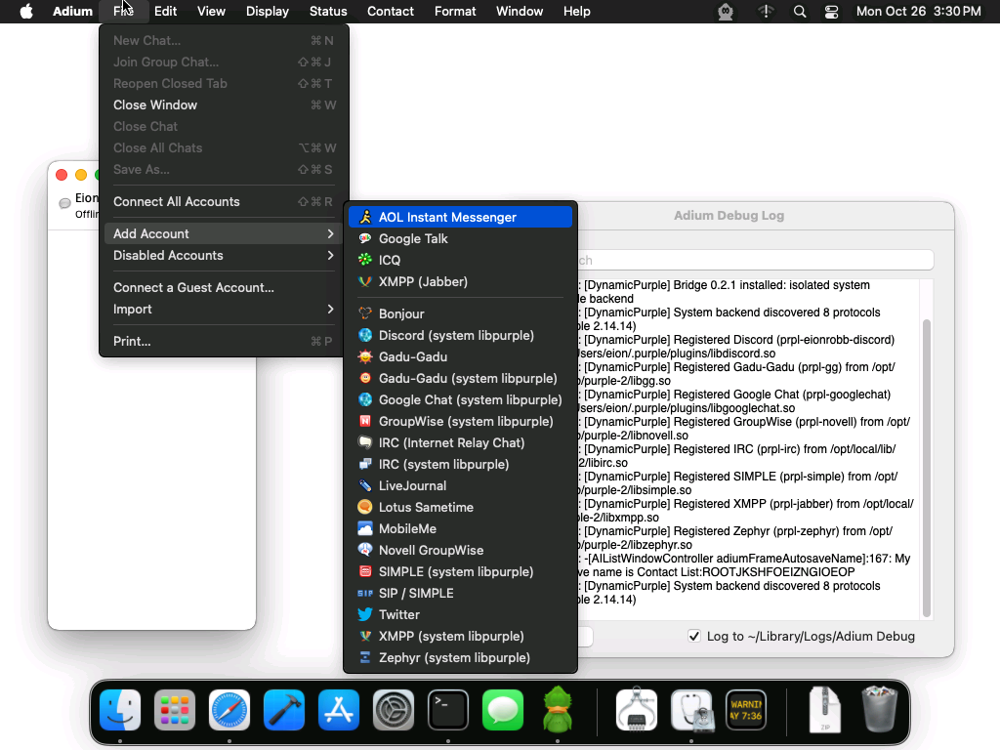

# Dynamic Purple for Adium

Use modern libpurple protocols in Adium without needing a separate Adium wrapper plugin for each one.

Dynamic Purple uses your system's **libpurple 2** to load protocol plugins from `~/.purple/plugins/` and add them as individual services in Adium, including protocols such as Discord and Google Chat.

## Install

1. Download the latest ZIP from the [Releases page](https://github.com/EionRobb/adium-dynamic-purple/releases/latest) and unzip it.
2. Drag `DynamicPurple.AdiumLibpurplePlugin` into Adium, or double-click it to install.
3. Restart Adium, then choose your protocol from **File → Add Account**.

Requires system libpurple 2 and JSON-GLib (MacPorts packages `libpurple` and `json-glib`), plus the protocol plugins you want to use. The current release is for Intel Macs.
